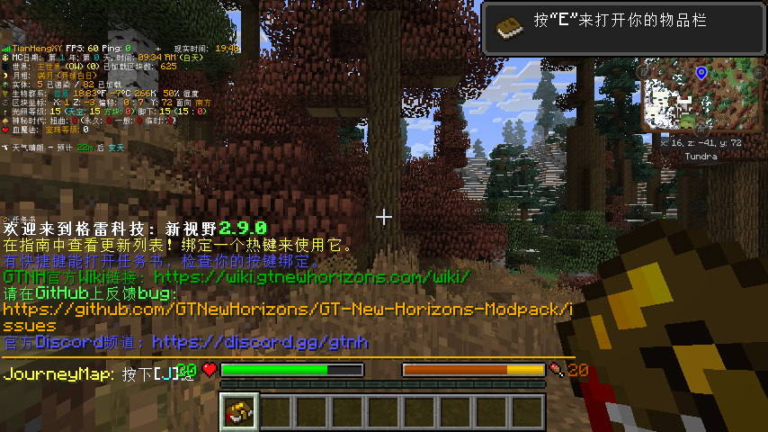
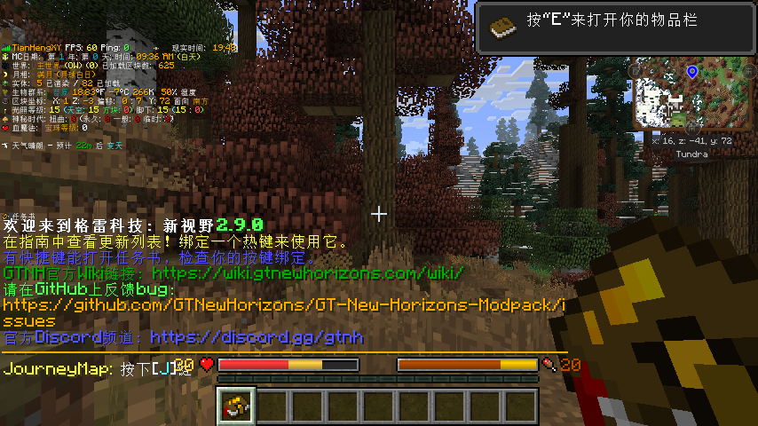
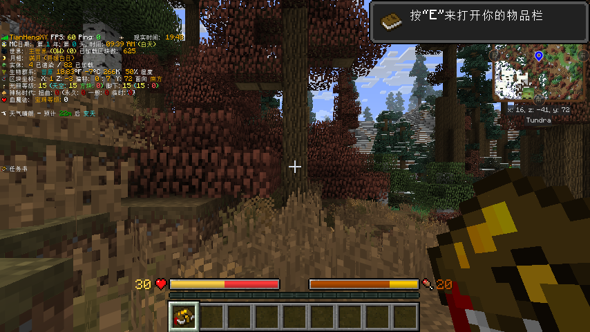
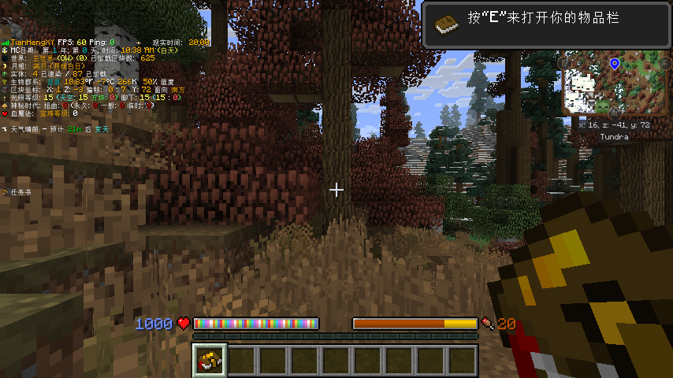
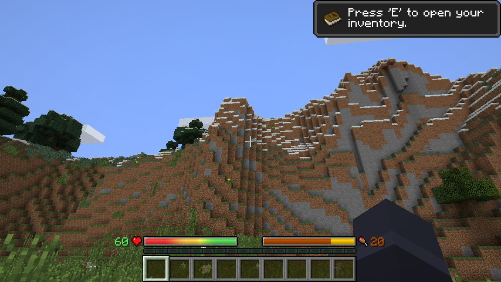
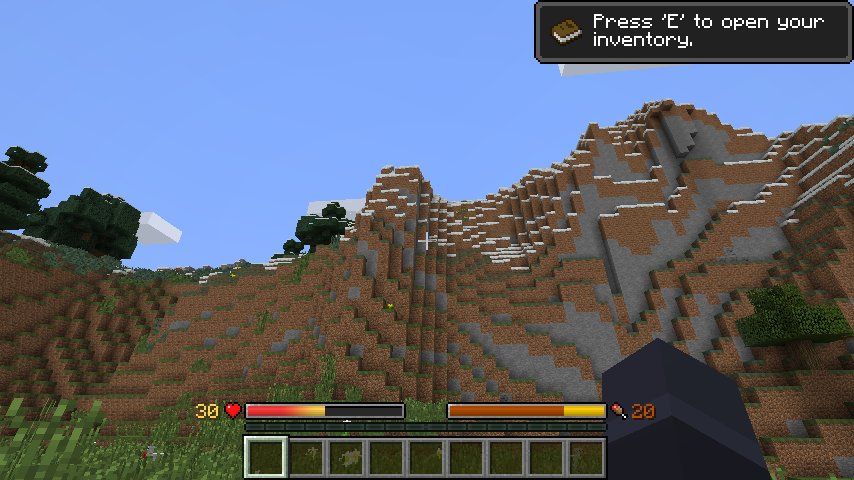

# ClassicBar — 1.7.10 / GT New Horizons 移植版

把 [Tfarcenim/ClassicBar](https://github.com/Tfarcenim/ClassicBar)（上游 1.19.2 版本 6.2.1）移植到
Minecraft **1.7.10**，面向 **GT New Horizons 2.9.0**。

原版 HUD 的两排图标被替换为条状进度条，血条宽度随最大生命值缩放。

## 功能

| 条 | 说明 |
| --- | --- |
| 生命 `health` | 宽度随最大生命缩放；最大生命超过 20 时可选单色 / 分层 / 重叠三种样式；中毒 / 凋零变色与纹理叠加；受伤时闪烁与残影 |
| 护甲 `armor` | 超过 20 点护甲时按层换色；护甲即将损坏时闪烁警告 |
| 吸收 `absorption` | 按每 20 点一层换色，超过最大生命时正确循环 |
| 饥饿 `food` | 饥饿值 + 饱和度双层显示；手持食物预览（闪烁）；消耗度叠加 |
| 氧气 `air` | 水下时显示，数值为气泡数 |
| 坐骑生命 `health_mount` | 骑乘时顶替饥饿条位置，与原版一致 |

- 图标、数字、颜色、条的左右顺序全部可配置。
- 饱和度与消耗度由服务端同步（1.7.10 原版不向客户端同步这两个值）。
- 客户端 `/classicbar reload` 重新读取配置。

### 血条样式（最大生命 > 20）

`general.health_layer_mode` 可选三种：

| 值 | 效果 |
| --- | --- |
| `single` | 单色：和以前一样整条连续填充，颜色按血量比例渐变 |
| `layered` | 分层：每 20 点为一层，各层在条上**并排**显示（0–20 红、20–40 金……） |
| `overlap` | 重叠：每层都从条的同一端开始画，后一层**盖在前一层上**，和 TConstruct 彩色心的显示方式一致（血量 ≥ 20 时条为满宽，靠颜色表示层数） |

每层颜色由 `colors.health_layer_colors` 配置（默认 10 色）；层数超过颜色数量时颜色循环使用，
所以 1000 点最大生命会有 50 段彩虹条，不会卡死或崩溃。

### 矢量渲染与分层渐变

分层血条不再使用位图纹理，而是**矢量绘制**（参考 Crosshair-Selection 的彩色几何绘制思路）：

- 填充部分按**屏幕分辨率**切分（1 个屏幕像素宽一列，而不是 1 个 GUI 单位），
  每列左右顶点带不同的颜色，由 GPU 逐片元插值；
- 颜色在 **HSV 空间**混合（色相走最短路径），交界处不会发灰；
- 混合曲线用 **smoothstep** 缓入缓出，两端没有生硬的起止；
- 垂直明暗（E6/FF/E6/CD/B4）用顶点颜色还原，和原来的血条观感保持一致；
- `general.health_layer_gradient` 控制交界处渐变宽度（单位：生命值，默认 16，0 = 硬边，
  设为 20 时整层连续过渡）。

### 与 Tinkers' Construct 的兼容

TConstruct 的 `HealthBarRenderer` 会自己绘制整行彩色心（包括 20 点以上的额外心），
并且在 `RenderGameOverlayEvent.Pre(HEALTH)` 里直接 `setCanceled(true)`，所以单纯取消事件无法阻止它，
会出现“原版血条没消失”的情况。

ClassicBar 在客户端 `postInit`（所有模组注册完毕后）通过反射把 TConstruct 的
`tconstruct.client.HealthBarRenderer` 从 Forge 事件总线**注销**，改由 ClassicBar 绘制血条；
TConstruct 本体、心罐、护甲等功能完全不受影响。

### 与 AppleCore 的兼容

检测到 AppleCore（GTNH 的 AppleCore Unofficial）时：

- 饥饿条读取 AppleCore 的 `getFoodValuesForPlayer` 计算手持食物预览，因此 Hunger Overhaul 等
  通过 AppleCore 改过的食物数值也能正确显示；
- 消耗度叠加层使用 AppleCore 的 `getMaxExhaustion` 作为满值（而不是写死的 4）；
- 饱和度 / 消耗度直接使用 AppleCore 自己同步到客户端的数据，ClassicBar 不再重复发包
  （AppleCore 自带 `MessageSaturationSync` / `MessageExhaustionSync`）；
- AppleCore 3.3.13 没有提升饥饿上限（仍是 0–20），所以饥饿条宽度仍以 20 为满值。

AppleCore 是可选依赖：没有安装时自动回到原版逻辑（ItemFood + 反射读取消耗度 + 自己的同步）。


## 环境 / 兼容性

- Minecraft 1.7.10，Forge `10.13.4.1614`（GTNH 2.9.0 使用的版本）。
- 使用 GTNHGradle `2.0.33` 构建，产物为 **Java 8 字节码**，可在 GTNH 2.9.0 自带的 Java 25 运行时下加载。
- 纯客户端模组：只装在客户端即可使用。装在服务端（或单人游戏）时会额外同步饱和度 / 消耗度。
- 不依赖 Mixin / UniMixins / GTNHLib，不会与 GTNH 的 coremod 冲突。

## 构建

需要 JDK 21+ 和网络（首次构建会下载 Forge / MCP / Minecraft 资源）：

```bash
./gradlew build
```

产物：`build/libs/classicbar-<version>.jar`（使用不带 `-dev` / `-api` / `-sources` 的那个）。

## 安装

把 jar 放进 `.minecraft/mods/`。GTNH 2.9.0 实例的 mods 目录同样适用。

## 配置

首次启动生成 `config/classicbar.cfg`，也可以在**模组列表（Mod List）里选中 Classic Bar，点 “Config”** 打开游戏内配置界面。
界面语言跟随游戏语言：中文环境显示中文分类/选项/提示（`zh_CN.lang`），英文环境显示英文（`en_US.lang`）。

- `general`：图标开关、各条数字开关、饱和度/手持食物/消耗度叠加、低护甲警告、满条背景、`health_layer_mode`（单色/分层/重叠）等
- `colors`：各条颜色、生命值分段颜色与分界点、`health_layer_colors`（每 20 点血一层的颜色）
- `order`：左右两列自下而上的条顺序（`left_order` / `right_order`）

在配置界面点 Done 会自动保存并立即生效（监听 FML 的 `ConfigChangedEvent`，无需重启）；
手动改文件后也可以执行 `/classicbar reload`。


## 与上游的差异

- 1.7.10 没有护甲韧性（armor toughness）属性，因此没有该条。
- GTNH 2.9.0 不包含 Tough As Nails（口渴）、ParCool（体力）、Vampirism（血液）等模组，
  因此没有移植这些兼容条；公共 `BarOverlay` API 保留，其他模组可以自行注册。
- 游戏内配置 GUI 基于 FML 1.7.10 自带的 `cpw.mods.fml.client.config.GuiConfig`（通过 `guiFactory` 注册），
  与配置文件、`/classicbar reload` 并存。
- 生命条/坐骑血条的闪烁使用 1.7.10 的 `hurtResistantTime`，与上游 1.19 的实现等价。

## 实现要点

- 通过取消 `RenderGameOverlayEvent.Pre` 的 `HEALTH / ARMOR / FOOD / AIR / HEALTHMOUNT`
  隐藏原版图标行，在 `RenderGameOverlayEvent.Post(ALL)` 中统一绘制条，坐标系与 Forge
  `GuiIngameForge` 的 `left_height / right_height` 一致（39 起步，每行 +10）。
- 使用 1.7.10 `icons.png` 的原始 UV（心形 52/61、中毒 88/97、凋零 124/133、吸收 160/169、
  护甲 34/25/16、食物 52/61、饥饿效果 88/97/133、气泡 16/18、马心 88/97、背景 52/61）。
- 消耗度通过 `ObfuscationReflectionHelper` 读取 `FoodStats.foodExhaustionLevel`，
  在开发环境与生产环境（SRG 名）下都可用。
- 网络：`classicbar` 通道，两条 `IMessage`（饱和度 / 消耗度），服务端每 tick 检测变化并下发。

## 验证

- `gradlew build` 通过，release jar 已 reobf 到 SRG 名。
- 开发客户端实机截图验证：普通状态、中毒 + 水下（氧气条）、骑乘（坐骑血条顶替饥饿条）。
- **GTNH 2.9.0 实机验证**（Prism 实例，242 个模组，Java 25 + lwjgl3ify/RFB）：
  - `Classic Bar` 正常出现在模组/资源包列表中，`config/classicbar.cfg` 自动生成；
  - 进入世界后 HUD 正常渲染：左侧生命条 + 心形图标 + 绿色数值，右侧饥饿条 + 饱和度叠加 + 鸡腿图标 + 数值；
  - 日志无本模组相关异常。
- **最大生命兼容测试**（模拟 +20 最大生命，等价于 Tinkers 心罐等 +HP 模组，30/40 血量）：
  - `single`：75% 宽的单一渐变颜色（与加分层之前一致）；
  - `layered`：0–20 红 + 20–30 金，两段并排；
  - `overlap`：金色层直接盖在红色层上（左金右红、满宽），与 TConstruct 彩色心一致；
  - 同时验证护甲 20、吸收 10、饥饿 15/饱和 6、中毒纹理叠加；
  - TConstruct 的 `HealthBarRenderer` 成功从事件总线移除（测试标记 `removed=1`），不再出现重复彩心。

| single | layered | overlap |
| --- | --- | --- |
|  |  |  |

- **高血量测试**（同样在 GTNH 2.9.0 实机自动截图）：
  - 60 / 100 / 200 / 1000 最大生命均正常，分层数量分别为 3 / 5 / 10 / 50；
  - 200 血：10 段颜色各不相同；1000 血：50 段颜色循环，无卡顿、无异常；
  - 低血量 25/200：条很短，红段 + 一小段金段；
  - 200 血 `overlap`：150/200 显示为左橙（最高层）右白（下一层）。




- **矢量渐变测试**（开发客户端，60 最大生命，GUI 缩放 2 → 按 154 个屏幕像素采样）：
  - 60/60 与 30/60：红→金、金→绿在 ~40 屏幕像素内平滑过渡，逐像素色差平均 ~3、无台阶；
  - 垂直明暗与原版血条一致（#E63535 / #FF3B3B / #CD2F2F / #B42929）；
  - `health_layer_gradient=0`：恢复硬边。





## 更新日志

- **1.4.9**
  - 把 HUD 绘制时机改到 `Post(HOTBAR)`：聊天框在它之后绘制，所以血条真正位于聊天框下层（被聊天背景压暗），
    与其它模组/原版心形一致；不再需要隐藏或手动变暗
- **1.4.8**
  - 打开任意界面时 ClassicBar 条与原版条一起隐藏（不再压暗显示、不会遮挡聊天文字），关闭界面后恢复
- **1.4.7**
  - 打开聊天框等界面时，HUD 条以 45% 透明度显示，视觉上位于界面下层（不急抢文字）
- **1.4.6**
  - 打开聊天框等界面时血条继续显示，但绘制在界面下层：聊天文字/背景盖在血条上，不会挡住文字
    （原版心形保持隐藏，不会再冒出来）
- **1.4.5**
  - 打开 GUI 时既不再画 ClassicBar 的条，也不再显示原版心形（继续隐藏原版条），HUD 干净地让位给界面
- **1.4.4**
  - 打开任意 GUI（聊天、背包、配置界面等）时不再绘制 ClassicBar 血条，避免盖在聊天框/界面上层
- **1.4.3**
  - 修复配置界面（Mod List → Config）改值不生效/不保存的问题：改在 FML 事件总线上监听
    `ConfigChangedEvent`，并直接应用界面写入的内存值（不再从磁盘重读覆盖），修改即时生效并写回文件
  - `/classicbar reload` 仍然用于重新读取手动编辑过的配置文件
- **1.4.2**
  - 恢复原版血条的垂直明暗（矢量绘制，颜色 E6/FF/E6/CD/B4 与原纹理一致），保留平滑渐变
- **1.4.1**
  - 渐变加宽（默认 4 → 16 点生命）并改用 smoothstep 缓动，交界处不再有明显色阶
- **1.4.0**
  - 分层血条改用矢量渲染：按屏幕分辨率切分、GPU 逐片元插值、HSV 颜色混合，实现平滑渐变
  - 新增 `health_layer_gradient` 配置（默认 4 点生命宽，0 = 硬边）
- **1.2.1**
  - 移除 1.3.x 的渐变实验（效果不理想），分层血条恢复为硬边分段配色
- **1.2.0**
  - 配置界面支持中文本地化（`assets/classicbar/lang/zh_CN.lang` + `en_US.lang`），
    分类、选项名、悬浮提示都会跟随游戏语言
  - 清理 1.1.0 测试版遗留的 `enable_health_layers` 配置项
- **1.1.0**
  - 生命条支持最大生命 > 20 的分层显示，三种模式：`single` / `layered` / `overlap`
  - 兼容 TConstruct 的彩色心渲染（注销其 HUD 渲染器，保留模组本体）
  - 兼容 AppleCore：食物预览、最大消耗度、饱和度/消耗度同步
  - 增加 Mod List 内的游戏内配置界面（`guiFactory` + `GuiConfig`）
  - 分层颜色扩到 10 色并在超出后循环
- **1.0.0** 首个 1.7.10 / GTNH 2.9.0 移植版本
